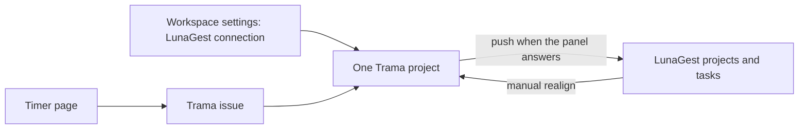

# Plan: LunaGest on one project, and a Trama timer

**Mode:** Full
**Status:** Slice 4 ready for review. Replaces the earlier read-only import proposal in this file.

## Goal and non-goals

**Goal.** Alessandro works in Trama, not in LunaGest's project screens. A workspace can store one LunaGest connection. A single Trama project can turn that connection on and bind one LunaGest project. Projects and tasks he creates or edits in Trama are pushed to LunaGest when the panel answers. If it does not answer, the Trama object still exists, and he later creates the remote or picks an existing one and links it. If something changed on LunaGest, he can realign that one project into Trama himself. Time is tracked in Trama, on a new timer page, and is not sent to LunaGest.

**Non-goals.**

- Importing the whole LunaGest account, or turning the connection on for every project.
- Writing time, clock punches, absences, overtime, or approvals to LunaGest. Hours stay in Trama. People who only look at LunaGest will not see them, and `actual_hours` there will not move.
- The rest of Toggl Track: calendar, clients, tags, billable rates, invoices, budgets, reports, approvals, profitability, desktop or mobile apps, idle detection.
- Automatic background sync or webhooks. The capture does not show webhooks. Realign is a button.
- A retry that creates a second remote task by itself. The observed `POST /functions/v1/pm?resource=tasks` has no idempotency key.
- HR, CRM, budgets, invoices, notifications, the realtime socket.
- Putting the password, the `apikey`, or a token in git, logs, or API responses.

This lifts [`NON-GOALS.md`](../NON-GOALS.md) item 6 (no timers or timesheets) only for the timer described here, and it adds a binding control to Projects, which that file marks frozen. Both edits land in the slice that introduces the behavior, not before.

## Acceptance criteria

- [ ] A workspace admin can save a LunaGest connection (base URL, username, password, `apikey`). The secrets are encrypted the same way tracker tokens already are. Reading the connection never returns them.
- [ ] Other projects in the workspace do not call LunaGest and do not show its data.
- [ ] On one project, he can choose a remote project or create one. The Trama project keeps working if that call fails, and the screen says it is not linked.
- [ ] Creating or editing an issue on a linked project pushes the task when LunaGest answers, and stores the remote id. If the push fails, the issue is still saved and can later be pushed again or linked to a task he selects from that remote project.
- [ ] Realign on that project pulls remote project and task changes. A field changed on both sides since the last sync is not overwritten. He picks a side.
- [ ] A Timer page lets him start one running timer, stop it, add a manual entry, and see his entries. An entry can name a project and an issue. Nothing is sent to LunaGest.
- [ ] Tests never call `https://panel.lunagest.com`.

## Current state and evidence

**Verified in this repo.**

- Settings already has an Integrations section for git hosts and Delta ([`src/app/features/settings/sections/integrations-section.ts`](../src/app/features/settings/sections/integrations-section.ts)) and a separate Import section for one-shot GitHub Issues and Linear imports. The import adapter contract is read-only ([`ImportSourceAdapter`](../server/src/importers/types.ts)). `ExternalProvider` is `'github' | 'linear'` and the comment says nothing is written back ([`contracts/domain.ts`](../contracts/domain.ts)). That importer is the wrong engine for a live, per-project, two-way link.
- Tracker secrets are AES-GCM encrypted and stripped from responses ([`TrackerCredentialEntity`](../server/src/importers/entities.ts), [`CredentialsService`](../server/src/importers/credentials.service.ts)).
- A project is `name`, `key`, `summary`, `description`, `status`, dates. No external id ([`ProjectEntity`](../server/src/database/entities/index.ts)). Issues already have `externalRef`, but that type has no "push failed" or "local only" state.
- Sidebar entries live in [`src/app/layout/sidebar.ts`](../src/app/layout/sidebar.ts). Routes live in [`src/app/app.routes.ts`](../src/app/app.routes.ts). There is no time-entry table and no timer page.
- [`NON-GOALS.md`](../NON-GOALS.md) item 6 forbids timers and timesheets. Projects are frozen: a new feature there needs a recorded decision first. The same file says linking an existing tracker is a gap that matters.

**Verified from the untracked inventory** `lunagest-api-docs/README.md` (passive capture, 28 Oct 2026, not a contract, not in git).

- Base `https://panel.lunagest.com`. Headers observed: `apikey`, `content-type`, `x-client-info`. Password grant observed at `POST /auth/v1/token?grant_type=password`. The body and the tokens were not recorded. Refresh was not observed.
- `GET /functions/v1/pm?resource=projects` and `GET /functions/v1/pm?resource=tasks` (`project_id`, `mine`). Task fields include `id`, `title`, `description`, `status`, `priority`, `due_date`, `project_id`, `parent_task_id`, `updated_at`. Status and priority enums were not captured.
- Writes observed, and marked as not safe to treat as a production API: `POST` and `PUT /functions/v1/pm?resource=tasks`, `DELETE` of a task. No project-create call was in the capture.
- Time reads exist (`pm?resource=time-entries`, `hr?resource=time-logs`) and a clock write exists (`POST hr?resource=clock`). They are out of scope. The time-entries body in the capture was empty, so its schema is unknown.

**Assumed.**

- Username plus password is not enough. The panel also sent `apikey`. The connection form asks for it. If a real login works without it, drop the field.
- The password grant body is the usual email and password form. Slice 1 stops if the first login fails. Do not guess other auth calls.
- No project-create endpoint was captured. Slice 2 may only bind an existing remote project until a create call is observed. Do not invent `POST pm?resource=projects`.
- One running timer per user per workspace.
- On realign, a field edited on both sides since `lastSyncedAt` is a conflict. Only-Trama and only-LunaGest changes apply in that direction. Status is included only after a real response shows the enum. Until then, status is shown as remote text and does not change the Trama issue status.
- Assignees are not mapped to Trama users. The remote name is display-only.

## Decision

Keep this off the importer and off the git Integrations provider list. Add a workspace connection plus a per-project binding.

The importer copies a whole tracker once and never writes. Git integrations are GitHub, GitLab, Bitbucket, and Delta. LunaGest is a panel session, a project binding, and a later manual repair. Folding it into either one would make every project, or every git connection, carry a password login and a write path.

Time stays a Trama table. Pushing it to the LunaGest clock would recreate the HR timesheet he is leaving, on an endpoint the capture says not to call.

Create is not atomic. He reversed that rule: the Trama issue exists even when the panel is down. Linking or creating the remote is a later manual action. An automatic retry is forbidden.

## Proposed design



Proposed, not taken from existing code. Secrets reuse `SecretsService` the way [`CredentialsService`](../server/src/importers/credentials.service.ts) already does.

```ts
// proposed rows, not an existing schema
type LunaGestLinkState = 'linked' | 'local_only' | 'push_failed';

// one connection per workspace for this provider
// secret encrypts { username, password, apiKey }
// never selected back out to the client

// project_links: at most one per Trama project
// remoteProjectId is null while local_only

// issue_links: at most one per issue
// remoteTaskId is null until he pushes or picks one
// lastSyncedAt is the conflict baseline
```

Push and realign go through `safe-fetch`, the same outbound guard as the importer. The password is sent only to the configured base URL, which must be `https://panel.lunagest.com` unless he sets another `https` host. Login uses the stored password only when there is no token or the panel returns 401. The token is held in memory or in the same encrypted secret, never logged.

Conflict rule, assumed:

| Since last sync | Action |
|---|---|
| Only Trama changed | Push that field. |
| Only LunaGest changed | Pull that field. |
| Both changed | Leave both. Show them. He chooses. |
| Never synced | Do not pull over a local issue. He links or pushes. |

Timer page, desktop, proposed:

```text
Timer
[ description.............. ] [ project / issue ] [ start ]
Today
  09:10–10:40   Fix login     PROJ-12     1h 30m
  manual entry  [ + Add ]
```

One running entry has `endedAt = null`. Starting another stops the previous one. Manual entry requires a start and an end. Delete is allowed on his own entries. No edit of someone else's entries.

## Reviewable slices

### Slice 1 — Connection and one project binding

**Outcome.** He can save the connection and attach one existing LunaGest project to one Trama project. A failed login does not change the project. No other project calls LunaGest.

**Scope.** Encrypted connection, `GET` projects, project settings control, link row with `remoteProjectId`. Record in `NON-GOALS.md` that a project may bind one external project. No task writes. No timer.

**Verification.** Unit tests: secret is not in the JSON response, wrong password surfaces as a rejected login without the password in the error, a second project has no link. No live HTTP.

**Stop** for review.

### Slice 2 — Tasks: push, or link later

**Outcome.** On a linked project, creating and editing an issue pushes title and description when the panel answers. On failure the issue stays, state `push_failed` or `local_only`, and he can retry the create or pick a remote task from that project. Picking a task that is already linked to another issue is rejected.

**Scope.** Issue link row. `POST` and `PUT` tasks only. No delete push. No project create unless a create call has been captured by then.

**Verification.** Unit tests with a fake panel: 201 stores the remote id, 500 keeps the issue and stores no remote id, a second push uses `PUT` on the stored id, picking an already linked remote id fails.

**Stop** for review.

### Slice 3 — Manual realign

**Outcome.** A button on the linked project pulls that remote project and its tasks. The conflict table above is what the tests lock.

**Scope.** One project. No scheduler.

**Verification.** Fixture tests for only-remote, only-local, and both-changed. Both-changed must not write.

**Stop** for review.

### Slice 4 — Timer

**Outcome.** The Timer page in the sidebar does start, stop, manual add, and list, optionally tied to a project and an issue. No LunaGest call.

**Scope.** `time_entries`, route, sidebar item, API. Amend `NON-GOALS.md` item 6 in this slice so the written scope matches the product. One running timer per user.

**Verification.** Unit tests: a second start stops the first, an end before the start is rejected, an entry cannot be written onto another user's row, and the LunaGest client is not invoked.

**Stop** for review.

## Verification

Server unit tests for each slice, then `npm test`, `npm run lint`, and `npm run build` in `server/` before that slice is called ready. The Timer page needs a manual pass in the app. Do not point e2e at a real LunaGest account.

## Release and rollback

Each slice is safe to land alone. Slice 1 with no binding is inert. Dropping the later slices leaves saved credentials. Those credentials must be deletable from settings in slice 1, including the encrypted secret. There is no production migration of old issues. New tables only.

## Risks

- The capture is not a contract. Slice 1 stops on the first failed login instead of trying nearby URLs.
- Storing the panel password means Trama holds a key that, in the capture, can also read people, absences, and every project. The UI binding does not remove that. Restrict the connection to workspace admins. Do not add HR reads "while we are there".
- Project create on LunaGest is unverified. Binding an existing project is the only promised path.
- Task status values are unknown. Guessing a map would silently move Trama issues.
- `lunagest-api-docs/` stays untracked. Do not commit it.

## Open

Nothing else blocks the slices. The conflict rule and the decision that hours never go to LunaGest are assumptions already stated above. Change them before slice 3 or slice 4 if they are wrong.
